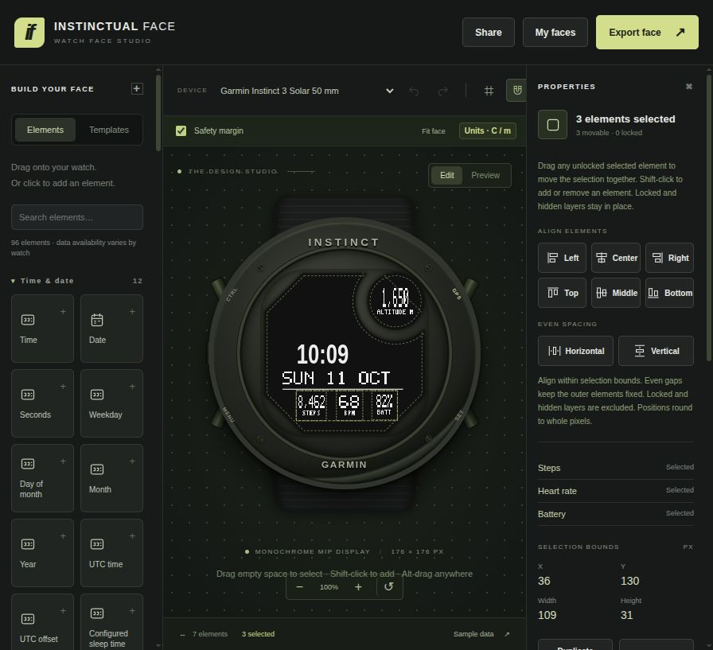

# Instinctual Face

A self-hosted drag-and-drop studio for Garmin Instinct Connect IQ watch faces. Design for Instinct 2, 3 Solar, 3 AMOLED, E, and Crossover variants; share portable templates; and build signed watch files with automated SDK setup and a one-time Garmin sign-in.



The editor uses plain browser JavaScript and a Node.js server with no npm dependencies or database. Optional compilation uses Garmin’s official Connect IQ SDK, Java, and authenticated device profiles. Docker includes Java and Python; SDK files are downloaded into the persistent volume after license acceptance, and the server generates a private signing key automatically.

## Run with Docker

With Docker and Docker Compose installed, clone the project and start it:

```sh
git clone https://github.com/SixtyAteWhiskey/instinctual-face.git
cd instinctual-face
docker compose up --build -d
```

Open [http://localhost:8080](http://localhost:8080). Compose starts a nonroot Node container, maps host port `8080` to application port `3000`, and mounts the persistent `instinctual-face-data` named volume at `/app/data`. The image includes a healthcheck against `/api/health`.

The image and Compose stack were built and verified on October 12, 2026, including persistent faces and shared templates across container recreation. The image uses Node.js 24, Java 17, and Python 3. Garmin's SDK, profiles, credentials, and signing keys are not bundled in the image.

```sh
docker compose logs -f instinctual-face
docker compose stop
docker compose start
```

## Run directly

Use Node.js 22 or newer. There are no dependencies to install:

```sh
npm start
```

Open [http://localhost:3000](http://localhost:3000). For development, `npm run dev` restarts the server when its files change. Configure the port or storage location with environment variables:

```sh
PORT=3001 DATA_DIR=./my-faces npm start
```

## Set up Garmin compilation

On an x64 Ubuntu 22.04/24.04 desktop or the corresponding Linux Mint release, open the app using **localhost**, then choose **Export face → SDK setup → Set up & open Garmin**. Read and accept Garmin’s developer agreement in the setup panel first. Setup checks Java and Python, downloads the official SDK and SDK Manager, verifies compatibility libraries against signed APT metadata, and opens Garmin’s Manager. Approve any administrator prompt on your desktop; no terminal commands are needed.

Sign in inside Garmin’s window and download your watch under **Devices**; for either Instinct 3 Solar case size, choose the shared `instinct3solar45mm` profile. Instinctual Face never receives your Garmin credentials. Downloaded profiles appear automatically, and the application creates its private signing key when preparing a build. **Open SDK Manager** reopens installed tools without another download.

Docker already includes Java and Python and can download the SDK from this panel, but its server cannot open an application on the browser client’s desktop. SDK Manager runs separately on your desktop; read-only mounts in `compose.profiles.yaml` import its downloaded profiles automatically. Remote browsers and headless servers use the guided manual fallback. macOS and Windows currently use Garmin’s official Manager and existing-SDK configuration. See [the compilation guide](docs/COMPILATION.md) for details and the optional CLI workflow.

The server listens on `0.0.0.0`, so it is also reachable through the host's LAN address. This version has a shared collection and no login: anyone who can reach it can view, change, and delete its saved designs. Use it on a trusted machine or LAN. For access over the internet, place it behind a reverse proxy with authentication and HTTPS.

## Design a face

1. Choose your watch in the device selector: Instinct 2 / 2S / 2X, Instinct 3 Solar 45 / 50 mm, Instinct 3 AMOLED 45 / 50 mm, Instinct E 40 / 45 mm, or Crossover / Crossover AMOLED. Switching models scales the layout and converts colors for monochrome targets. Original Instinct and original Solar hardware have no Connect IQ watch-face support.
2. Start with **Summit**, **Minimal**, or **Trail** in the Templates tab, or use **My faces → New face**.
3. Drag an item from the Elements library onto the watch, or click it to add. Drag selected elements to position them. Drag empty canvas space to select several elements at once; any layer touched by the box is selected. Shift-click on the canvas or in Layers to add or remove an element. Alt-drag starts a selection box anywhere.
4. Use Properties to set pixel position, width, height, font size, alignment, and color. Changing Width or Height scales the primary value; dragging the corner handle resizes both dimensions. Under **Caption**, independently change the label words, size, gap, alignment, and color. Caption size stays independent when resizing the box. Font size remains a separate fine adjustment. MIP uses black and white; AMOLED supports full RGB colors. Time supports 12-hour and 24-hour formats; dates have short and long formats; data fields have optional captions.
5. Use Layers to select, hide, duplicate, delete, or move an element forward or backward. Lock an element to protect its position and style. A multi-selection shows group bounds and controls to duplicate, delete unlocked layers, lock/unlock, and hide/show. **Align elements** lines up left/right/top/bottom edges or horizontal/vertical centers within the visible, unlocked selection bounds. **Even spacing** requires at least three movable elements and creates equal horizontal or vertical gaps, keeping the first and last elements fixed. Locked and hidden elements are excluded from alignment and spacing. Each operation is one undo step; an operation that would cross a safety boundary or create overlapping gaps is skipped with an explanation. With safety enabled, centers and gaps round to watch pixels and can differ by one pixel. Drag an unlocked selected member to move the group with its spacing intact; locked and hidden members stay in place. Group movement stops at display and circle boundaries. Selection is temporary editor state and does not travel with saved faces, exports, or templates.
6. Safety margin is enabled by default. Its guides keep layers inside the visible main display and circular window, away from the opaque bezel. **Fit face** commits the fitted positions; switch the margin off for free placement. The setting travels with saved designs and share codes. Toggle the pixel grid and 4-pixel snapping, change zoom, and use undo or redo while editing. Switch to **Preview** to hide the editing controls on the watch.
7. Choose **Units** above the canvas to use Celsius/Fahrenheit, kilometers/miles and pace, meters/feet, wind speed, pressure, kg/lb, and centimeters/feet-inches. Use Metric or US / imperial presets, or mix individual choices. Preferences travel with the design and share code, and apply to preview, SVG, and the built watch file.
8. Open **Sample data** to try different readings before exporting. Enter samples and custom distance goals in the selected units; changing units preserves their physical values.

The searchable library includes time/calendar components, activity goals and totals, health history (including Body Battery, stress, and oxygen), weather and forecasts, device status, supported training/event complications, custom text, shapes, icons, and progress bars/rings. Data availability depends on the model, firmware, and recorded or synced data; missing values show `--`. See [the element and caption guide](docs/ELEMENTS.md) for the complete catalog, units, permissions, and limitations. Preview values are simulated; generated source reads available watch data.

| Shortcut | Action |
| --- | --- |
| Arrow keys | Nudge selected visible, unlocked elements by 1 pixel |
| Shift + arrow keys | Nudge by 10 pixels |
| Ctrl / Command + Z | Undo |
| Ctrl / Command + Shift + Z, or Ctrl / Command + Y | Redo |
| Ctrl / Command + A | Select all visible layers in Edit view |
| Shift + click | Add or remove a selected element |
| Ctrl / Command + D | Duplicate selected elements |
| Delete / Backspace | Delete selected unlocked elements |
| Ctrl / Command + S | Save now |
| Escape | Clear the selection |

## Save, back up, and export

Design changes save automatically to the server and are cached in the current browser. **My faces** lets you open, create, duplicate, delete, and import designs. If the server becomes unavailable, the status changes to **Saved in browser**, and editing continues with a local backup. Browser storage belongs to that browser and site address; use a JSON download to transfer a face or keep an independent backup.

The **Export face** menu provides:

- **Build & download watch file:** A signed device-specific `.prg` when the SDK and matching watch profile are ready. Otherwise, the panel guides setup and profile import.
- **Connect IQ project ZIP:** Monkey C source, manifest, build configuration, resources, instructions, and the editable design JSON.
- **Editable design JSON:** A complete layout that can be imported through **My faces → Import JSON**. Import creates a separate design.
- **Preview SVG:** A vector image using the current simulated preview data.

The ZIP is source code for manual building and simulation. For the integrated compiler, follow [the compilation guide](docs/COMPILATION.md): complete the automated setup, sign in to Garmin SDK Manager once and download your watch, build, then copy the `.prg` to `GARMIN/APPS` by USB. Downloaded profiles are discovered automatically; **Check profiles now** also checks immediately. Safety-enabled circular windows use the same compact pixel lettering and fitted geometry in the browser and exported watch face. Main display fonts remain approximate because Garmin’s built-in fonts vary by watch; the export measures live text and uses a compact fallback when no native font fits. Instinct E window geometry uses a conservative approximation. Verify those layouts in Garmin’s simulator and on the watch. See [Garmin export and device support](docs/GARMIN.md) for supported variants, SDK canvas dimensions, and installation instructions. AMOLED exports include a separate dim, moving time-only always-on layout. Crossover physical hands may cover screen elements, so check their placement on hardware.

## Share templates

Open **Share** to copy an `IF1` code or save the current layout to **Templates → Shared templates**. Use **Templates → Use a share code** to inspect someone’s design before adding it as an independent face. You can keep its watch model or adapt it to yours. Portable codes work across instances without a public template service.

Codes contain canonical, size-limited layout JSON plus a SHA-256 checksum. The checksum detects corruption and identifies a template; it does not authenticate its creator. Safety comes from strict field/type validation and escaped text. Templates cannot contain source code, scripts, commands, assets, remote URLs, or compiler paths. See [sharing details](docs/SHARING.md).

Shared templates persist in `data/templates.json` and deduplicate by content hash. Project designs and template codes are shared among users of this instance; browser backups remain available when the server is offline.

For a native run, server designs are stored in `data/projects.json` relative to the working directory, or in the directory set by `DATA_DIR`. Docker stores that file at `/app/data/projects.json` inside the named volume. Writes are serialized and replace the JSON file atomically. The server preserves a design's edit timestamp and ignores older delayed saves when a newer version is already stored.

After saving at least one design, back up the volume's project file with:

```sh
docker compose cp instinctual-face:/app/data/projects.json ./projects-backup.json
```

To restore a backup, stop the application, copy it into the container's persistent data directory, and start it again:

```sh
docker compose stop instinctual-face
docker compose cp ./projects-backup.json instinctual-face:/app/data/projects.json
docker compose start instinctual-face
```

Back up the full data volume privately to preserve shared templates and the compiler’s signing key, in addition to projects. `docker compose down` preserves the named volume. Adding `-v` removes its saved data. JSON exports are useful for individual faces; the server file contains the whole collection.

## Development and validation

```sh
npm run check
npm test
npm run verify:runtime
npm run verify:docker
```

All 241 tests and JavaScript syntax checks passed on October 12, 2026. Tests cover project/template persistence, concurrent writes, request validation, static-file isolation, layouts, secure share codes, Garmin source/ZIP generation, SDK extraction, signing-key handling, and bounded compiler execution.

`verify:runtime` starts a temporary local server and checks all 11 profiles, selection and arrangement geometry, saved-face and template restart persistence, source ZIP/SVG exports, and rejected unsafe inputs. It leaves existing designs and SDK tools alone. `verify:docker` requires a working Docker daemon and Compose; it builds the image, checks health and nonroot execution, runs the runtime checks inside the image, and verifies volume persistence across container recreation. Its disposable stack, volumes, and image are removed afterward.

The included GitHub Actions workflow runs syntax, tests, and runtime checks on Node.js 22 and 24, plus a Docker build and smoke check. Garmin compilation is a separate check using authenticated profiles; Solar 3 device-specific builds passed on the desktop and in Docker with read-only profile imports. The final desktop face ran in Garmin's simulator, with 36 native rendering and unit checks passing; the earlier first face was also installed and confirmed on a physical Solar 3 watch. Other profiles and AMOLED always-on behavior still need their own device-specific checks. See [the validation record](docs/VALIDATION.md) for evidence and limits.

Main modules: `server.mjs` (HTTP), `templates.mjs` (shared template storage), `compiler.mjs` (trusted builds), `web/app.js` (editor), `web/workflows.js` (sharing and installation), `web/devices.js` (profiles), `web/elements.js` (trusted catalog), `web/model.js` (layout validation), `web/display-safety.js` (shared geometry), `web/selection.js` (selection, group movement, alignment, and spacing), `web/preview.js` and `web/pixel-font.js` (preview and compact lettering), `web/sharing.js` (portable codes), and `web/garmin-export.js` (source generation). APIs include project CRUD, GET/POST `/api/templates`, GET `/api/compiler`, POST `/api/compiler/setup`, local-only POST `/api/compiler/desktop-setup` and `/api/compiler/open-manager`, POST `/api/compiler/refresh`, and POST `/api/build`. Build requests accept design data only.

See [the roadmap](docs/ROADMAP.md) for possible next additions. Instinctual Face is an independent project and is not affiliated with Garmin.
